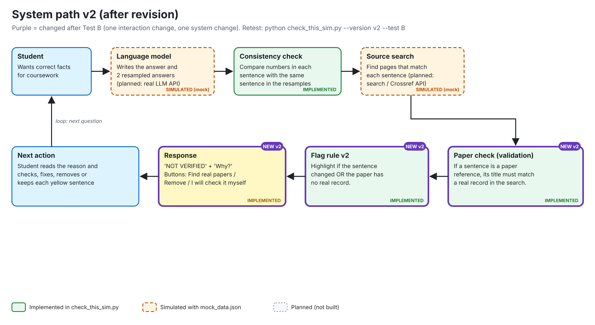

# 01_SPEC.md: use case and system path

Use this file for the use case from your Week 2 storyboard. Keep the notes short enough to use while you work.

Use case from my Week 2 storyboard (`storyboard/week2_normal_storyboard.png`, `storyboard/week2_failure_recovery.png`): a student asks a study chatbot a question, and the system marks the sentences in the answer that may be unreliable ("Check this").

Route: small prototype (Python simulation). Run it with `python check_this_sim.py --all`. To see what the student would see, open `compare_view.html` in a browser: it shows v1 and v2 side by side as chat screens for each test. The language model and the source search are **mocked** with `mock_data.json`. The checks, the flag rule and the response are **implemented** in `check_this_sim.py`. A real LLM API and a real search API are **planned**, not built.

## User goal
A student wants to use correct facts and real sources in their coursework, and wants to know which parts of a chatbot answer they need to check.

## System inputs
- From the student: a question in text (for example a fact question, or a request for a source).
- Data the system receives: [MOCKED] one model answer, already split into sentences, and two resampled answers to the same question; [MOCKED] results from a source search for each sentence.

## Processing and technology
| Step | What it does | Technology | Status |
|---|---|---|---|
| 1 | Write the answer and 2 resampled answers | Language model | Simulated (`mock_data.json`); planned: real LLM API |
| 2 | Compare the numbers in each sentence with the same sentence in the resamples | Python rule in `check_this_sim.py` | Implemented |
| 3 | Search for sources that match each sentence | Source search | Simulated (small local index); planned: web search / Crossref API |
| 4 | Decide which sentences to highlight (flag rule) | Python rule | Implemented |
| 5 | Build the response with highlights and buttons | Python (text output) | Implemented; the real interface is planned |

## Intended result and next action
The system returns the answer with the unsure sentences in yellow and a "Check this" button, plus the sources it found. The student can open the sources, then check, fix, remove or keep each yellow sentence, and ask the next question.

## Fallback strategy
- No answer for the question (out of scope): say that this prototype cannot answer it.
- Information missing or vague: (added in v2) ask a clarifying question before trusting a source.
- Source search unavailable: (added in v2) say so at the top and mark every reference, number and date as "Not checked".

## System path or interaction diagram
- Before revision: `diagrams/system_path_v1.png`
- After revision: `diagrams/system_path_v2.png` (changes in purple)

Each box is labelled IMPLEMENTED, SIMULATED (mock) or planned.

## Test A: standard input
Full output: `test_runs/v1_testA.md`

Input:
"When was the Gutenberg Bible printed, and how many copies were made?"

What the system receives:
The question, a 3-sentence model answer, 2 resampled answers [mocked], and the source search results [mocked].

What it does:
The consistency check finds that sentence 2 says "500 copies", but the resamples say "180". Sentences 1 and 3 are the same in every answer. The source search finds sources for sentences 1 and 3, but none for sentence 2. Flag rule v1 highlights sentence 2 only.

Response and next action:
The answer is shown with "Gutenberg printed about 500 copies." in yellow with a "Check this" button. The student can open the sources, find that the number is about 180, and fix the sentence.

## Test B: problem input
Full output: `test_runs/v1_testB.md` and `test_runs/v1_testB_source_down.md`

Input:
"can u give me a source about AI in school for my essay" (vague: no clear topic, and it asks for a source)

What the system receives:
The question, a 2-sentence answer with a reference (Smith, J., 2021, a placeholder paper that does not exist) and 2 resamples [mocked], and source search results [mocked].

What it does:
The model gives the same reference in every resample, so the consistency check says it is consistent. The source search finds pages about "AI tutors" (a topic match), but no record of this paper. Flag rule v1 only looks at consistency, so the reference is **not** highlighted. Only "20%" is highlighted, because one resample says 35%. There is no check for the vague request. In the extra run with the search down, the search fails, but the response looks the same.

Response and next action:
The fake reference looks trusted (no highlight), and the "sources found" make it look even safer. The student would probably copy it into the essay. The system never asks which part of "AI in school" the student means.

## Review and revision
Use the tests to identify an interaction or system problem. Note the evidence, then describe one interaction change and one technology or system change. Explain why the changes help and run Test B again.

### Review of Test A and Test B (v1)
| Question | Evidence | Problem found |
|---|---|---|
| Did the system make clear what it can and cannot do? | Test B: a highlight means "the model was not consistent", but the student cannot see this. A paper with no highlight looks checked. | Yes, problem: the student cannot tell what "no highlight" means. |
| Did it show what it understood or extracted from the input? | Test A: the yellow sentence and the sources are shown. Test B: nothing shows that the request was understood as only "AI + school". | Partly. It does not show how it understood a vague request. |
| Could the person correct a wrong extraction or decision? | Test A: "Check this" lets the student fix sentence 2. Test B: no button on the reference, because it is not flagged. | Problem: the student cannot correct a decision they cannot see. |
| Did it ask for missing information instead of guessing? | Test B: "a source about AI in school" is answered at once with one paper. | Problem: it guesses the topic and gives a source anyway. |
| Did it keep the person in control of the next action? | Test A: yes, the student decides what to check. Test B: the student is led to trust the reference. | Problem in Test B. |
| Did it respond honestly when a tool was unavailable? | `v1_testB_source_down.md`: the search failed, but the response is the same and gives no warning. | Problem: not honest about the failed check. |

**Main problem I chose:** in Test B a made-up reference is shown as if it were safe. The flag rule only checks consistency, and a model can repeat the same wrong reference every time. The system also does not ask about the vague request.

### Interaction change
1. **Clarifying question:** when a source request has very few topic words, the response starts with "Your request is broad. Which part of 'AI in school' is your essay about?" with options: AI tutors / AI and exams / Teachers using AI / Type my own topic.
2. **Visible reason and options:** an unchecked reference is labelled **NOT VERIFIED** with a "Why?" reason and three buttons: Find real papers / Remove this reference / I will check it myself. Real papers from the search are listed separately.

### Technology / system change
1. **Validation step:** each sentence gets a type (reference, number/date or general). A reference must match a real paper record by its title (exact title lookup, planned: Crossref API). A number must appear in a source that was found. Flag rule v2 = not consistent **or** not verified.
2. **Request check:** a simple rule finds vague source requests before the answer is trusted.
3. **Fallback:** if the search is down, the system says so and marks every reference, number and date as "Not checked".

Updated diagram: `diagrams/system_path_v2.png`

### Test B again (v2)
Full output: `test_runs/v2_testB.md` and `test_runs/v2_testB_source_down.md`. Run: `python check_this_sim.py --version v2 --test B`

| | v1 | v2 |
|---|---|---|
| Vague request | answered at once | clarifying question with 4 topic options |
| Fake reference (Smith 2021) | no highlight, looks trusted | yellow, **NOT VERIFIED**: "no matching record for this paper was found in the paper search, so it may not exist" + buttons |
| "20%" sentence | yellow, no reason | yellow + reason: "the numbers changed when the model answered again (also said 35)" |
| Real papers | not offered | 2 real papers from the search, with "open them before you use them" |
| Search down | no warning | notice at the top; facts marked "Not checked" |

Test A was also run again with v2 (`test_runs/v2_testA.md`). The result is the same as v1 (sentence 2 is yellow), but now it shows a reason, and sentence 1 (date supported by a found source) is marked "Checked". So the change did not break the standard case.

**Why the changes help:** in v1 the system only asked "did the model say the same thing twice?", and a model can repeat the same wrong reference every time. v2 also checks the reference against a real record, so the fake paper is caught, and the "Why?" reason shows the student what was and was not checked. The clarifying question and the "Not checked" notice keep the student in control, because the system asks instead of guessing and is honest when a tool fails.
