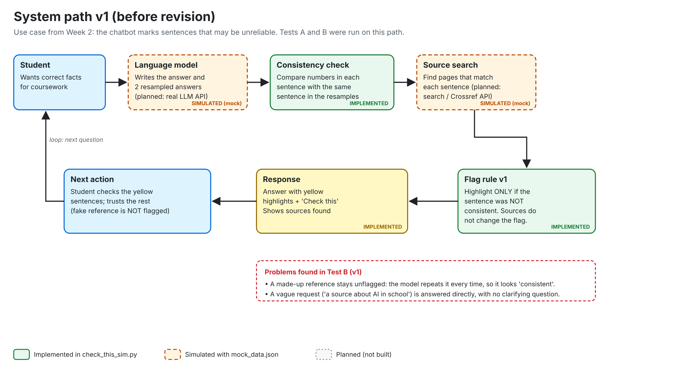

# 01_SPEC.md: use case and system path

Use this file for the use case from your Week 2 storyboard. Keep the notes short enough to use while you work.

Use case from my Week 2 storyboard (`storyboard/week2_normal_storyboard.png`): a student asks a study chatbot a question, and the system highlights the sentences in the answer that may be unreliable ("Check this").

Route: small prototype. `check_this_sim.py` runs the path. The language model and the source search are **mocked** with `mock_data.json`. The checks and the highlight rule are **implemented**. A real LLM API and a real search API are **planned**. Run `python check_this_sim.py --all` to make the test records in `test_runs/`.

## User goal
A student wants to use correct facts and real sources in their coursework, and wants to know which parts of a chatbot answer they need to check.

## System inputs
- From the student: a question in text.
- The system also gets: the model's answer (split into sentences), the same question answered 2 more times, and source search results for each sentence. All of these are mocked.

## Processing and technology
| Step | What it does | Technology | Status |
|---|---|---|---|
| 1 | Write the answer, and answer the same question 2 more times | Language model | Simulated (`mock_data.json`); planned: real LLM API |
| 2 | Check if the numbers in each sentence stay the same in the other answers | Python rule | Implemented |
| 3 | Search for sources for each sentence | Source search | Simulated; planned: search / Crossref API |
| 4 | Decide which sentences to highlight | Python rule | Implemented |

## Intended result and next action
The answer is shown with the unsure sentences in yellow and a "Check this" button. The student can check, fix, remove or keep each yellow sentence.

## Fallback strategy
- No answer for the question: the prototype says it cannot answer it (implemented).
- Source search not available: tell the student that the facts were not checked (planned).

## System path or interaction diagram
`diagrams/system_path_v1.png` (each box is labelled implemented, simulated or planned)

## Test A: standard input
Run: `python check_this_sim.py --version v1 --test A` (record: `test_runs/v1_testA.md`)

Input:
"When was the Gutenberg Bible printed, and how many copies were made?"

What the system receives:
The question, an answer with 3 sentences, 2 more answers and the source search results (mocked).

What it does:
Sentence 2 says "about 500 copies", but the other answers say 180, so it is highlighted. Sentences 1 and 3 are the same in all answers, so they are not highlighted.

Response and next action:
"Gutenberg printed about 500 copies." is yellow with a "Check this" button. The student checks it, finds "about 180" and fixes the sentence. **It works as planned.**

## Test B: problem input
Run: `python check_this_sim.py --version v1 --test B` (record: `test_runs/v1_testB.md`)

Input:
"can u give me a source about AI in school for my essay" (vague, and it asks for a source)

What the system receives:
The question, an answer with a paper reference "Smith, J. (2021). AI Tutors in Secondary Schools…" (a placeholder paper that does not exist) and a sentence "AI tutors improved test scores by 20%", 2 more answers and the source search results (mocked).

What it does:
The model gives the same paper in every answer, so the paper is **not** highlighted. Only the "20%" sentence is highlighted, because one answer says 35%.

Response and next action:
The fake paper has no highlight, so it looks safe, and the student would probably copy it into the essay. **Problem found.**

## Review and revision
Use the tests to identify an interaction or system problem. Note the evidence, then describe one interaction change and one technology or system change. Explain why the changes help and run Test B again.

### Review
| Question | Evidence | Problem |
|---|---|---|
| Did the system make clear what it can and cannot do? | Test B: the paper has no highlight, but this only means "the model said the same thing 3 times". | The student thinks "no highlight" means "checked". |
| Could the person correct a wrong decision? | Test A: yes, with "Check this". Test B: the paper has no button, because it is not highlighted. | The student cannot correct a mistake they cannot see. |
| Did it ask for missing information instead of guessing? | Test B: "a source about AI in school" is answered at once with one paper. | It guesses the topic (not fixed in this lab). |
| Did it keep the person in control of the next action? | Test B: the student is led to trust the paper. | The student is not given a choice about the paper. |

**Problem I chose:** a made-up paper gets through, because the system only checks if the model says the same thing every time.

### Interaction change
A paper that cannot be found is highlighted with the label **NOT VERIFIED**, a short "Why?" reason, and three buttons: Find real papers / Remove this reference / I will check it myself.

### Technology / system change
A validation step: if a sentence is a paper reference, its title must match a real record in the paper search (planned: Crossref API). The new rule is: highlight if the sentence changed **or** the paper has no real record.

Updated diagram: `diagrams/system_path_v2.png` (changes in purple)

### Test B again (v2)
Run: `python check_this_sim.py --version v2 --test B` (record: `test_runs/v2_testB.md`)

| | v1 | v2 |
|---|---|---|
| Fake paper (Smith 2021) | no highlight, looks safe | yellow, **NOT VERIFIED**, "Why? no record of this paper was found…", 3 buttons |
| "20%" sentence | yellow | yellow + "Why? the number changed when the model answered again (it also said 35)" |

**Why the changes help:** in v1 the system only checked if the model repeated itself, and a model can repeat the same wrong paper every time. The new validation step checks the paper against a real record, so the fake paper is caught. The NOT VERIFIED label, the reason and the buttons show the student what went wrong and let them decide what to do next.
